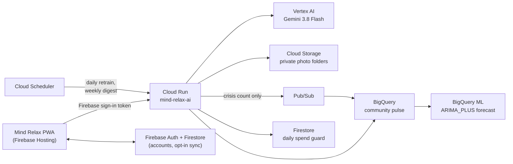

# Mind Relax

A private AI journal for everyday mental wellbeing. Write, speak or photograph
whatever is on your mind; Gemini helps you think it through, shows how your
mood is moving, and points to real help when things get heavy.

Built for the **Google Cloud AI Builder Cup 2026 — Sustainability & Social
Impact** track.

## Submission links

| | |
|---|---|
| **Live app** | https://mindrelax-app-2026.web.app |
| **Demo video (3 min)** | _Link added on 18 Oct, once the video is uploaded._ |
| **Source code** | https://github.com/HappyyyyTingting/mind-relax |
| **Team** | Rushikesh Hulage, Tingting Yu |

**To try it:** open the live app and sign up with any email and a password
(sign-in is what unlocks the Gemini features). Write a few entries, then try
Talk, Recap, the weekly review and its coach, and Insights. To see a group's
community pulse, join with the code **DEMO-CAMPUS**. The first AI reply after a
quiet spell can take about 20 seconds while the server wakes up.

Mind Relax is a self-reflection tool, not a medical service.

## Why it matters

Most people never talk to anyone about a hard day. Journaling helps, but a
blank page in a language that is not your own, with no feedback, rarely
sticks. Mind Relax lowers every barrier we could find:

- **No setup and no cost to the user:** AI runs on our Cloud Run server, with no
  API key and no download.
- **Six languages:** English, 中文, हिन्दी, Bahasa Melayu, 日本語 and 한국어,
  so people can write the way they think.
- **Any way to write:** type, speak, or snap a photo of a paper diary.
- **Safety first:** crisis words are caught in all six languages. The app then
  shows a fixed, safe reply and local helplines (India, China, Malaysia,
  Japan, South Korea and more) instead of an AI answer.
- **Community without exposure:** people can opt in to share one anonymous
  number a day. Everyone then sees how the community is feeling, with a
  7-day forecast, and no one can be picked out.

## Features

- **Write, speak or photograph an entry.** Voice is turned into text by Gemini.
  A diary page is copied out, and other photos get a short caption.
- **Talk with AI:** a "thinking partner" chat that reads today's entries.
- **Daily recap and weekly review** written by Gemini.
- **Mood insights:** each entry gets a 1–5 mood score and one feeling word.
  Charts cover 7 or 30 days, with your most common feelings. The words you
  use most are counted on the device, in every mode.
- **Words, not scores:** being measured is a pressure of its own for some
  people. One switch turns mood scores off: nothing is sent to be scored, no
  number is shown, shared or given to the coach. Only the word counts stay.
- **Community pulse:** an opt-in, anonymous daily community mood (only days
  with 10+ people are shown) and a 7-day BigQuery ML forecast.
- **Crisis safety:** phrase check in six languages, a fixed safe reply, and
  a helpline card.
- Edit, merge, search and browse entries by day. Drafts survive a reload.
- Local-first storage (IndexedDB) with opt-in multi-device sync.
- Email / password accounts, JSON backup export and import.
- On-device Gemma as a fully offline, private alternative to Gemini.

## How it uses Google Cloud



| Service | What it does here |
|---|---|
| **Vertex AI (Gemini 3.8 Flash)** | Chat replies, recaps, voice-to-text, reading diary photos, mood scores |
| **Cloud Run** | The AI server (`services/ai-proxy`): checks sign-in, limits and safety, calls Gemini |
| **Cloud Storage** | Photos, one private folder per user, only readable through the server |
| **BigQuery** | Anonymous daily mood numbers, safety counts and the weekly digest |
| **BigQuery ML** | `ARIMA_PLUS` 7-day forecast of the community mood |
| **Pub/Sub** | Carries anonymous safety events straight into BigQuery |
| **Cloud Scheduler** | Retrains the forecast daily and writes the weekly digest |
| **Firebase** | Auth, Firestore (sync and the daily spend guard), Hosting |

## Privacy by design

- Entries stay on the device unless the user turns on sync.
- Gemini sees only what a reply needs. Voice clips are never stored.
- Photos are private to their owner and deleted with the entry.
- The community pulse stores **one number per day**, never words. Each row
  has a scrambled key that changes every day, so one person cannot be
  followed across days. A day is hidden until at least 10 people shared.
  Turning sharing off deletes what was shared.
- Safety counts record only "crisis, language, date": no user, no text.
- Cost guard: sign-in is required, there is a per-user hourly limit, and a
  daily cap on AI calls and spend.

## Built during the Google Cloud AI Builder Cup 2026

Mind Relax started as a plain journaling prototype that Tingting built before
the event (writing and merging entries, email accounts, multi-device sync).
It had no AI. Everything AI in this app was built during the official build
window, which opened on 7 September 2026. Before the event, the code lived in
an earlier private repository; we are happy to share its full history on
request.

**Before the event (prototype, no AI):**
- Recording, editing, merging and searching entries; the "today" view
- Email / password accounts and password reset
- Multi-device sync (then on Supabase)

**During the event (from 7 Sep 2026):**
- AI replies to entries, streamed as they are written (10 Sep)
- AI daily recap (10 Sep)
- "Talk with AI" thinking-partner conversation (16 Sep)
- Context handling: today's entries as background, trimming and rolling
  summaries for long chats (21 Sep)
- Chat experience: smart scroll, timestamps, drafts, retry, delete (21 Sep)
- Redesigned thinking-partner prompt (30 Sep)
- On-device Gemma running fully in the browser, for privacy (12 Oct)
- Move to Firebase (Auth, Firestore, Hosting) and English / Chinese UI (12 Oct)
- Opt-in sync per device and per-account data separation (13 Oct)
- **Google Gemini on Cloud Run** as the default AI, so nobody needs an API key
  or a 2 GB download (`services/ai-proxy`, 14 Oct)
- **Safety layer:** crisis phrase check in English and Chinese, a fixed safe
  reply instead of a model answer, and a helpline card in the app (14 Oct)
- **Cost guard:** sign-in required, per-user hourly limit, and a daily cap on
  calls and spend kept in Firestore (14 Oct)
- English prompts that follow the app language (14 Oct)
- Clearer write / talk / recap flow; Enter sends in Talk with AI (15 Oct)
- Entry types, so the AI never mistakes its own recap for the user's words;
  the AI replies in the user's language; weekly review; drafts kept (15 Oct)
- **Voice journaling** with Gemini speech-to-text (15 Oct)
- **Photo journaling:** diary page copy-out or caption, photos in private
  Cloud Storage folders (15 Oct)
- **Hindi, Malay, Japanese and Korean**, including crisis checks, safe replies
  and local helplines (15 Oct)
- **Mood insights:** Gemini mood scores and 7 / 30-day charts (15 Oct)
- **Community pulse:** opt-in anonymous mood numbers in BigQuery, shown only
  for groups of 10+, with a BigQuery ML forecast (15 Oct)
- **Safety counts and jobs:** Pub/Sub to BigQuery, Cloud Scheduler for the
  daily forecast retrain and the weekly digest (15 Oct)
- **Words, not scores:** a switch to turn mood scores off, and the most used
  words counted on the device (16 Oct)

## Tech Stack

React + TypeScript + Vite + Dexie.js + Tailwind CSS + Firebase (Auth, Firestore,
Hosting) + vite-plugin-pwa. AI: Gemini on Vertex AI via a Cloud Run service
(`services/ai-proxy`, see its README for routes, settings and the BigQuery /
Pub/Sub / Scheduler setup), or Gemma 4 in the browser via LiteRT-LM.

## Quick Start

```bash
npm install
npm run dev
```

Open http://localhost:5173.

## Build & Deploy

```bash
npm run build
firebase deploy --only hosting,firestore
```

## Notes

- The Firebase web config in `src/lib/firebase.ts` is public by design; data
  access is controlled by the Firestore security rules in `firestore.rules`.
- Sync compares `max(updatedAt, deletedAt)` per entry (last write wins); deletes
  are tombstones, never hard deletes.
